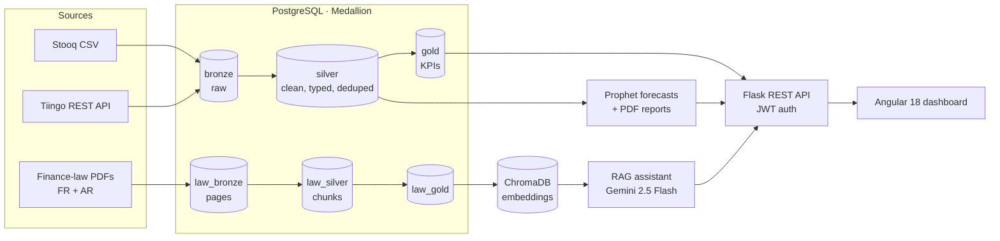

# SmartFinance Advisor

[](https://github.com/mo9tada/smartfinance-advisor/actions/workflows/ci.yml)


**A financial analytics platform: market data pipelines, risk indicators, price forecasting and an AI assistant that answers questions about Tunisian finance law.**

Built as my final-year engineering project (PFE). It ingests daily market data for US equities and the S&P 500, cleans it through a Medallion data architecture in PostgreSQL, and serves an Angular dashboard of returns, volatility, drawdowns and Prophet forecasts. A second pipeline turns Tunisian finance-law PDFs (French and Arabic) into a searchable knowledge base for a retrieval-augmented chat assistant.

## Architecture



### Market-data pipeline (Medallion)

| Layer | What happens |
| --- | --- |
| **Bronze** | Raw OHLCV rows from Stooq (CSV) and Tiingo (API), stored as received with source and ingestion time |
| **Silver** | Each source's columns are standardised, then merged; types enforced; duplicates, rows with missing prices, `high < low` and negative volume removed; sorted per ticker |
| **Gold** | Per-ticker KPIs (never mixing series): 12/24-period SMA, period return, rolling volatility, running peak, drawdown, range %, OHLC-consistency flag |

### Legal-document pipeline (RAG)

PDF pages are extracted with `pdfplumber` (bronze), cleaned and split into 1,500-character chunks with 200-character overlap and tagged as French or Arabic (silver), then stored with stable chunk IDs (gold) and embedded into ChromaDB. The assistant retrieves the most relevant chunks and answers with Gemini, keeping per-user chat sessions.

## Features

- **Dashboard**: overview KPIs, price charts, monthly returns, volatility and drawdown per ticker
- **Forecasts**: Prophet models for close, high and low prices, with a downloadable PDF report per ticker
- **AI assistant**: questions about Tunisian finance laws, answered from the source documents, with saved chat history
- **Pipelines from the UI**: start market-data or law ingestion and follow its status and logs live
- **Accounts**: registration with administrator approval, roles, password reset by email code, in-app notifications

## Tech

| Area | Stack |
| --- | --- |
| Data & ML | Python, pandas, NumPy, Prophet, pdfplumber, ChromaDB |
| Backend | Flask (blueprints), Flask-JWT-Extended, Flask-Bcrypt, Flask-Mail, PostgreSQL (psycopg2) |
| AI | Google Gemini 2.5 Flash (`google-genai`) with retrieval-augmented generation |
| Frontend | Angular 18 (standalone components), Chart.js via ng2-charts, Tailwind CSS |

## Run it locally

Requirements: Python 3.11+, Node 20+, PostgreSQL 14+.

```bash
git clone https://github.com/mo9tada/smartfinance-advisor.git
cd smartfinance-advisor
cp .env.example .env              # database, JWT secret, Tiingo + Gemini keys

# Database: create the schemas, then apply the migrations in order
psql -d trading_pipeline -f setup_database.sql
for f in backend/migrations/sprint*.sql; do python backend/migrate.py "$f"; done

# Backend
python -m venv .venv && source .venv/bin/activate
pip install -r requirements.txt
python backend/seed_admin.py      # first administrator account
python backend/start_api.py       # http://localhost:5000

# Frontend
cd frontend && npm ci && npx ng serve   # http://localhost:4200
```

To use the assistant, put the finance-law PDFs (published by the Tunisian government) in `data/law/` and start the law ingestion from the admin panel. The step-by-step guide is in [docs/RUNNING_GUIDE.md](docs/RUNNING_GUIDE.md), and the original French documentation is in [docs/fr](docs/fr).

## Testing

```bash
cd backend && pytest -v
```

Unit tests cover the Silver cleaning rules, per-ticker Gold KPIs and the law-document chunking. CI runs them on every push, along with a production build of the Angular app.

## Limitations and next steps

- Forecast metrics in the reports are **in-sample** (fit on the training data). The next step is walk-forward backtesting to measure real out-of-sample error.
- Gold KPIs use row-based windows. With daily data, a "12-period" SMA covers 12 trading days, not 12 months.
- Pipelines run in-process threads. A job queue (Celery or RQ) would make them resilient to API restarts.

## Author

**Moktada Zaidi** — [GitHub](https://github.com/mo9tada) · moktadazaidi@gmail.com
